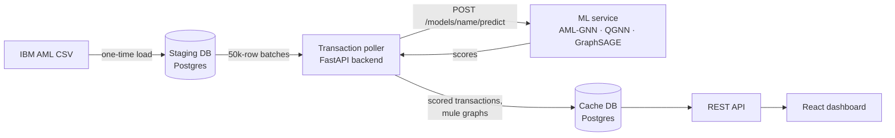

# Q-Detect: Hybrid Quantum-Classical Money Mule Detection

Q-Detect detects anti-money-laundering (AML) activity by treating financial transactions as a graph. Accounts are nodes and transactions are edges. Graph neural networks, including a **quantum GNN** built with PennyLane, score each transaction for laundering risk. Flagged transactions are then grouped into **mule networks** that analysts review in an interactive dashboard.

The project was built as a Curtin University capstone in partnership with Deloitte, using the [IBM Transactions for Anti-Money Laundering](https://www.kaggle.com/datasets/ealtman2019/ibm-transactions-for-anti-money-laundering-aml) synthetic dataset.

## Features

- **Graph-based fraud detection**: each transaction is scored as an edge using the context of the accounts around it
- **Four interchangeable models** served by a separate ML microservice, so you can switch between them with one environment variable:
  - **AML-GNN** (v1, v2): our own edge classifier. It uses GINEConv layers with separate message passing along and against the money flow, and is trained on the same 50k-transaction batches it scores in production.
  - **QGNN**: a hybrid quantum-classical GNN, where a 2-qubit PennyLane circuit adds to each edge's attention weight before message passing
  - **GraphSAGE**: a classical baseline
- **Production-style ingestion pipeline**: a poller replays the historical data in chronological 50k-row batches, stands in for transactions arriving over time, and keeps a crash-safe checkpoint
- **Incremental mule-network building**: flagged transactions create new graphs, grow existing ones, or merge them. Analyst decisions are kept, and a graph is marked as having new activity when it changes.
- **Analyst dashboard**: D3 network visualisation, transaction details, CSV export, Safe / Fraud / Pending decisions, notes, and light and dark themes
- **Microsoft Entra ID sign-in** in the frontend, using MSAL
- **Model evaluation script** that scores every model on unseen data through the same path the poller uses

## Architecture



1. `scripts/load_transactions.py` loads the CSV into the **staging DB** once, sorted so that `id` follows chronological order.
2. The **transaction poller** reads the next batch after its checkpoint and sends it to the **ML service** for scoring.
3. Scored transactions and accounts are written to the **cache DB**. Flagged transactions are then assigned to mule-network graphs.
4. The checkpoint moves forward only after a batch succeeds, so a crash re-runs that batch instead of skipping it.
5. The **React dashboard** reads clusters and graphs from the API. Analysts record decisions and notes, and these are saved back to the cache DB.

## Tech stack

| Layer | Tools |
|---|---|
| ML | PyTorch, PyTorch Geometric, PennyLane, scikit-learn, Polars, Jupyter |
| ML service | FastAPI (port 8001) |
| Backend | FastAPI, SQLModel, psycopg 3, pandas, NetworkX, httpx |
| Databases | PostgreSQL 17 (staging and cache) in Docker Compose |
| Frontend | React 19, Vite, Tailwind CSS, React Bootstrap, D3, MSAL |
| Tooling | uv, npm, pytest, Ruff |

## Repository structure

```
Q-Detect/
├── docker-compose.yml        # Staging DB (:5434) and cache DB (:5433)
├── Backend/
│   ├── main.py               # FastAPI app (port 8000)
│   ├── db.py                 # Staging and cache engines
│   ├── jobs/transaction_poller.py
│   ├── services/             # Scoring, cache store, graph store, clusters
│   ├── routers/              # Cluster and utility endpoints
│   ├── models/               # SQLModel tables
│   ├── scripts/              # Load CSV, evaluate models, reset, clear cache
│   └── tests/
├── ML/
│   ├── service.py            # Model-serving microservice
│   ├── amlgnn.py             # AML-GNN model and inference
│   ├── train_amlgnn.py       # AML-GNN training
│   ├── qgnn_inference.py     # Quantum GNN inference
│   ├── inference.py          # GraphSAGE inference and shared feature prep
│   ├── model/                # Trained model bundles (.pt)
│   └── experiments/          # Paused experiments (context_v3)
├── MachineLearning/          # Research notebooks
└── Frontend/
    └── src/
        ├── pages/            # Login, home dashboard, settings
        ├── components/       # MuleNetworkGraph (D3), MarkGraphStatus
        ├── api/              # API client modules
        └── auth/             # MSAL config
```

## Getting started

### Prerequisites

- Docker and Docker Compose
- Python 3.12+ and [uv](https://docs.astral.sh/uv/)
- Node.js 18+ and npm
- The IBM AML dataset file `HI-Small_Trans.csv` from [Kaggle](https://www.kaggle.com/datasets/ealtman2019/ibm-transactions-for-anti-money-laundering-aml)

### 1. Start the databases

Create a `.env` file in the repository root:

```env
STAGING_DB_USER=staging
STAGING_DB_PASSWORD=<password>
STAGING_DB_NAME=qdetect_staging

CACHE_DB_USER=cache
CACHE_DB_PASSWORD=<password>
CACHE_DB_NAME=qdetect_cache
```

```bash
docker compose up -d
```

### 2. Configure the backend

Create `Backend/.env`:

```env
STAGING_DATABASE_URL=postgresql+psycopg://staging:<password>@localhost:5434/qdetect_staging
CACHE_DATABASE_URL=postgresql+psycopg://cache:<password>@localhost:5433/qdetect_cache

ML_SERVICE_URL=http://127.0.0.1:8001
# Which model scores batches: amlgnn, amlgnn-v1, qgnn or graphsage
ML_MODEL=amlgnn

# Start the poller with the app, or leave false and start it from the API
AUTO_START_POLLER=false
```

### 3. Load the transactions

Put `HI-Small_Trans.csv` in `Backend/dataset/`, then run:

```bash
cd Backend
uv sync
uv run python -m scripts.load_transactions
```

### 4. Start the ML service

```bash
cd ML
uv sync
uv run main.py          # http://127.0.0.1:8001
```

It loads every model bundle in `ML/model/` at startup. Check which ones loaded at `GET /health`.

### 5. Start the backend

```bash
cd Backend
uv run main.py          # http://127.0.0.1:8000, docs at /docs
```

Run the backend with a single worker. The poller runs inside the app process, so extra workers would all pull the same batches.

Start scoring:

```bash
curl -X POST http://127.0.0.1:8000/api/util/jobs/start
```

A 50k-row batch is processed every 5 minutes.

### 6. Start the frontend

Create `Frontend/.env.local`:

```env
VITE_API_BASE_URL=http://localhost:8000
VITE_QDETECT_API_CLIENT_ID=<API app registration client ID>
```

```bash
cd Frontend
npm install
npm run dev             # http://localhost:5173
```

Sign-in uses Microsoft Entra ID. The tenant, client ID and redirect URI are set in `Frontend/src/auth/authConfig.js`.

## API reference

### ML service (`:8001`)

| Method | Endpoint | Description |
|---|---|---|
| `GET` | `/health` | Liveness check and which models are loaded |
| `GET` | `/models` | Every model's name and decision threshold |
| `GET` | `/models/{name}/info` | Bundle path, device, threshold and feature config |
| `POST` | `/models/{name}/predict` | Score a batch of transactions (raw IBM CSV columns) |

### Backend (`:8000`)

| Method | Endpoint | Description |
|---|---|---|
| `GET` | `/api/graph` | The whole laundering graph as `{nodes, edges}` |
| `GET` | `/api/graph/cluster/{id}` | One cluster as `{nodes, edges}` |
| `GET` | `/api/clusters?min_size=2&limit=20` | Largest laundering clusters |
| `GET` | `/api/clusters/{id}` | One cluster |
| `PATCH` | `/api/clusters/{id}/status` | Set an analyst decision: `Pending`, `Safe` or `Fraud` |
| `GET` / `POST` | `/api/clusters/{id}/notes` | Read or save a cluster's note |
| `GET` | `/api/accounts/{account_id}/cluster` | Find the cluster an account belongs to |
| `GET` | `/api/util/jobs/status` | Poller status |
| `POST` | `/api/util/jobs/start` / `stop` | Start or stop the poller |
| `POST` | `/api/util/ingestion/reset` | Reset the checkpoint to the start of the data |
| `POST` | `/api/util/cache/clear` | Empty the cache DB, including graphs, statuses and notes |

## Models

| Name | Type | Notes |
|---|---|---|
| `amlgnn` | Classical GNN (v2) | GINEConv with two-direction message passing over 23 edge features. Test AUPRC 0.452 on IBM HI-Medium. |
| `amlgnn-v1` | Classical GNN | First version, kept for comparison |
| `qgnn` | Hybrid quantum-classical GNN | A 2-qubit PennyLane circuit feeds into edge attention, followed by one message-passing hop and a linear edge classifier. Scores are seeded, so the same batch always gets the same scores. |
| `graphsage` | Classical GNN | GraphSAGE baseline trained on IBM HI-Medium |

The models were trained on **HI-Medium** and are served on **HI-Small**, so everything the pipeline scores is unseen data.

### Training AML-GNN

```bash
cd ML
uv run python train_amlgnn.py
```

Training checkpoints after every epoch and early-stops on validation AUPRC. See `ML/experiments/context_v3/SETTINGS.md` for a paused experiment that adds earlier transactions as context.

### Evaluating the models

Run this with the ML service and staging DB up:

```bash
cd Backend
uv run python -m scripts.evaluate_models
uv run python -m scripts.evaluate_models --batches 40 --models amlgnn graphsage
```

Results are written to `Backend/output/evaluation/`.

## Tests

```bash
cd Backend
uv run pytest
```

## Contributing

The team uses Gitflow, with `main`, `develop` and `feature/*`, `release/*` and `hotfix/*` branches. See [`git-procedures.md`](git-procedures.md) for details.

## Team

- Ashane Arangalla
- Thai Gia Ngan (Grey) Nguyen
- Clement
- Lachlan Bruce
- Wesley
- MrWang21

Built for the Curtin University capstone program in partnership with Deloitte.
